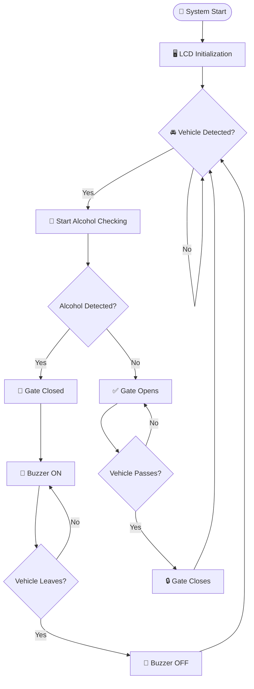

# 🚗 Alcohol Detection & Drunk Driving Prevention System

### 🛑 Smart Vehicle Safety Gate using Arduino

**An Arduino-based safety prototype that detects alcohol vapour and controls an automatic vehicle gate.**

---

## 📌 Project Overview

This project demonstrates a smart vehicle safety system designed to prevent drunk driving.

When a vehicle approaches the gate, the system checks the alcohol sensor reading and automatically decides whether to allow the vehicle to pass.

- ✅ **No Alcohol Detected:** Gate opens automatically.
- 🚨 **Alcohol Detected:** Gate remains closed and buzzer activates.
- 🔄 **Vehicle Leaves:** Gate automatically closes.

## ✨ Key Features

| Feature | Description |
|---|---|
| 🚘 Vehicle Detection | Detects approaching vehicles using an ultrasonic sensor |
| 🍺 Alcohol Detection | Detects alcohol vapour using MQ-3 sensor |
| 🖥️ LCD Display | Displays real-time system status |
| 🚧 Automatic Gate | Servo motor controls gate movement |
| 🔔 Alert System | Buzzer activates when alcohol is detected |
| 🌬️ Fan Control | Fan operates during the checking process |
| 🧪 Simulation | Test different scenarios online |

## 🧰 Hardware Components

| Component | Purpose |
|---|---|
| Arduino Uno R3 | Main controller |
| MQ-3 Alcohol Sensor | Alcohol vapour detection |
| 16×2 LCD Display | Display messages |
| Ultrasonic Sensor | Vehicle detection |
| SG90 Servo Motor | Automatic gate control |
| Piezo Buzzer | Warning alert |
| DC Fan | Ventilation during checking |
| Breadboard & Jumper Wires | Circuit connections |
| Potentiometer | Simulated alcohol input, if MQ-3 is unavailable |

## ⚙️ Working Principle

1. System starts and displays the welcome message.
2. Ultrasonic sensor detects an approaching vehicle.
3. Fan starts and alcohol checking begins.
4. Alcohol sensor reading is compared with a predefined threshold.
5. If alcohol is detected, the gate remains closed and buzzer turns ON.
6. If no alcohol is detected, the gate opens using the servo motor.
7. Once the vehicle leaves, the gate closes automatically.

## 🔄 System Flowchart

## 💻 Technologies Used

- 🔹 Arduino Uno R3
- 🔹 Arduino C/C++
- 🔹 Embedded Systems
- 🔹 Tinkercad Circuits
- 🔹 Electronic Sensors and Actuators

## ▶️ Simulation

The project can be simulated online using **Tinkercad Circuits**.

🔗 https://www.tinkercad.com/circuits

If MQ-3 is unavailable in the simulator, use a potentiometer as an analog input substitute to test the alcohol-detection logic.

## 🧪 Test Scenarios

| Test | Alcohol Input | Expected Result |
|---|---|---|
| Test 1 | Below threshold | ✅ Gate Opens |
| Test 2 | Above threshold | 🚨 Gate Locked + Buzzer ON |
| Test 3 | Vehicle Leaves | 🔒 Gate Closes + Buzzer OFF |

## ⚠️ Limitations & Safety

- A potentiometer is only a simulation substitute, not an actual alcohol sensor.
- MQ-3 readings depend on calibration, warm-up time and environmental conditions.
- The prototype does not measure blood-alcohol concentration or establish driver impairment.
- This project is intended for educational demonstration, not real-world driving or legal decisions.

## 👨‍💻 Developed By

**Hirday Lamba**,
**Saurabh Chaudhary** & 
**Krishna singh**

---

